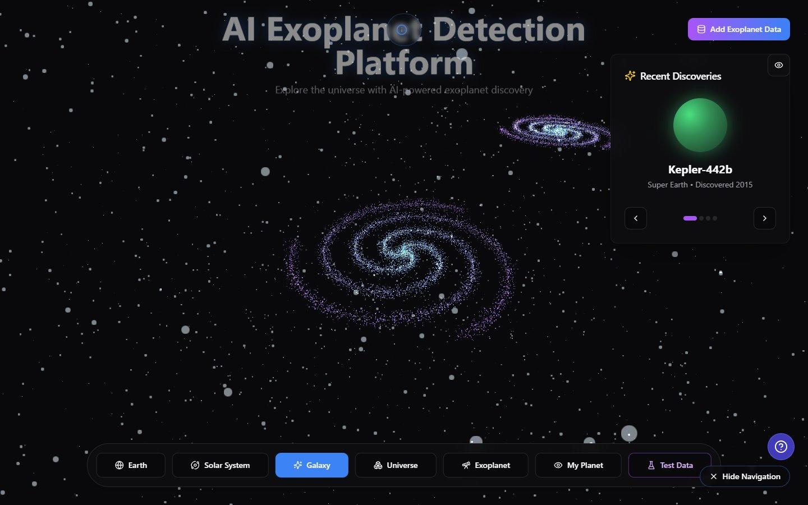
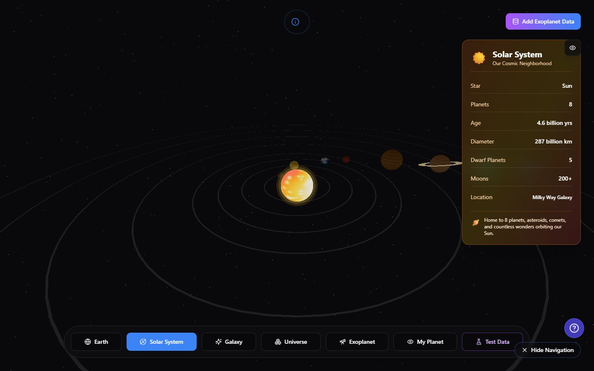
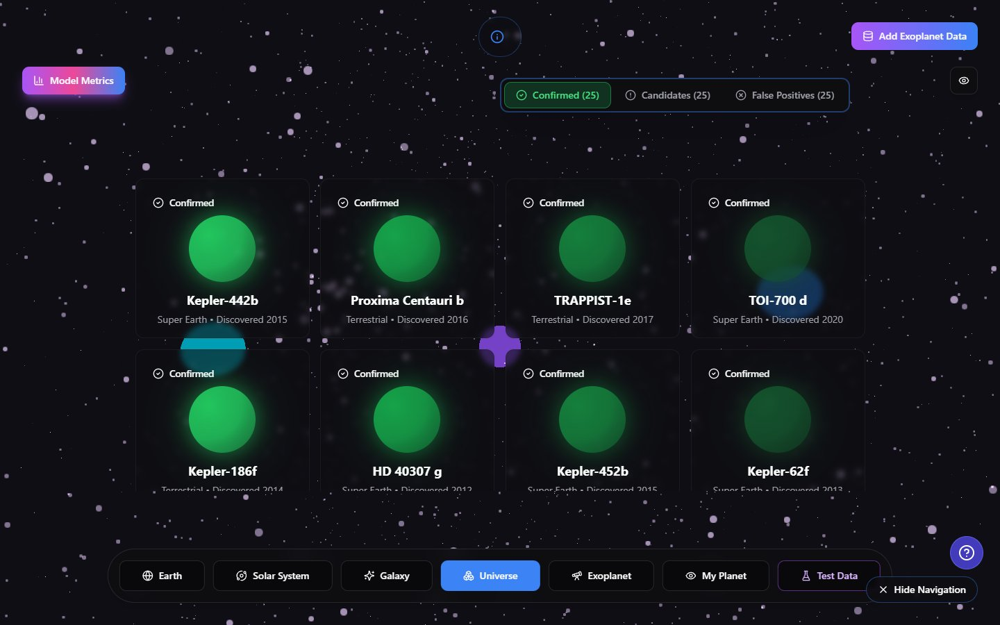
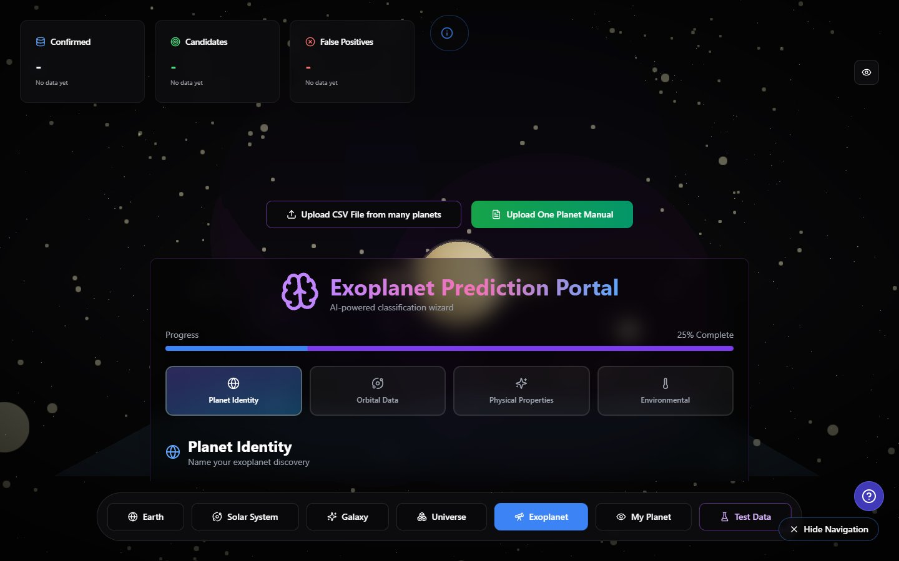
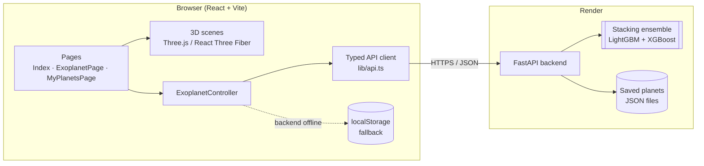
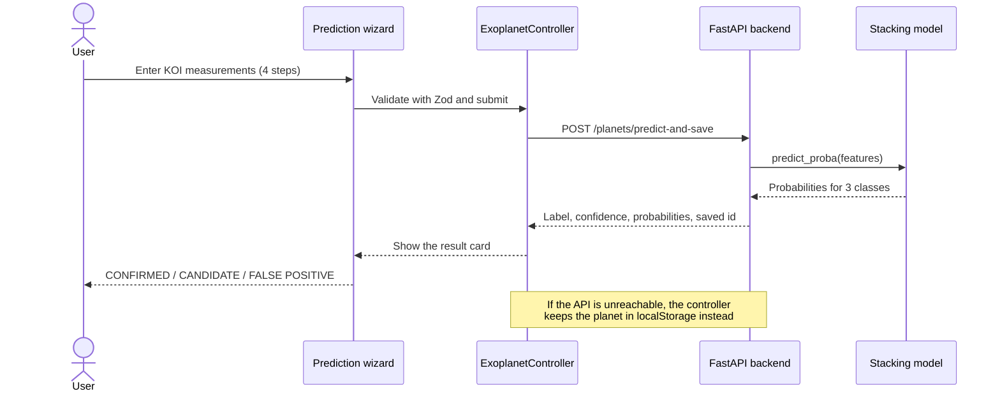

<div align="center">

# Cosmic Zoom Verse: Exoplanet Explorer

**An interactive 3D space explorer with an AI exoplanet classifier, built at the NASA Space Apps hackathon**

Fly from Earth to the edge of the Milky Way, enter the measurements of a Kepler Object of Interest (KOI),
and get a real-time classification (**confirmed planet**, **candidate** or **false positive**) from a
machine learning model trained on NASA's Kepler data.


**[🌐 Live demo](https://nasa-kepler-sight.onrender.com)** ·
[Backend repo](https://github.com/QaisRjoob/exoplanet-classifier-BackEnd) ·
[Screenshots](#-screenshots) ·
[Architecture](#-architecture) ·
[Quick start](#-quick-start)

</div>

<p align="center">
  
</p>

---

## Table of contents

1. [Live demo](#-live-demo)
2. [Overview](#-overview)
3. [Screenshots](#-screenshots)
4. [Features](#-features)
5. [Tech stack](#-tech-stack)
6. [Architecture](#-architecture)
7. [Prediction flow](#-prediction-flow)
8. [Project structure](#-project-structure)
9. [Quick start](#-quick-start)
10. [Deploy to Render](#-deploy-to-render)
11. [Team](#-team)
12. [Data source](#-data-source)

---

## 🌐 Live demo

| What | Link |
|---|---|
| **Web app** | https://nasa-kepler-sight.onrender.com |
| **Backend API** | https://nasa-kepler-sight-backend.onrender.com |
| Backend source | https://github.com/QaisRjoob/exoplanet-classifier-BackEnd |

> Hosted on Render's free plan: the backend sleeps after a period without traffic. The app shows a
> countdown toast while it wakes up and reloads itself when the API is ready.

---

## 📌 Overview

NASA's Kepler Space Telescope watched more than 150,000 stars and flagged thousands of **Kepler Objects
of Interest**: stars whose light dips as if a planet were crossing in front of them. Most of these turn
out to be false positives.

Cosmic Zoom Verse is the visual front end of a classification system that answers *"is this a planet?"*
for a new candidate. The 3D scenes make the scale of the problem tangible, and the prediction portal
sends the measurements to a **LightGBM + XGBoost stacking ensemble** served by a FastAPI backend.

| Concept | Meaning |
|---|---|
| **KOI** | A Kepler Object of Interest: a star with a transit-like signal |
| **Confirmed** | Verified as a real exoplanet |
| **Candidate** | Looks planetary, still needs follow-up observations |
| **False positive** | The signal is not caused by a planet (for example an eclipsing binary) |

---

## 📸 Screenshots

<table>
  <tr>
    <th>Solar system</th>
    <th>Confirmed planets</th>
  </tr>
  <tr>
    <td></td>
    <td></td>
  </tr>
</table>

<p align="center">
  <b>Exoplanet prediction portal</b><br>
  
</p>

---

## ✨ Features

**3D exploration**
- Seven views from one navigation bar: Earth, Solar System, Galaxy, Universe, Exoplanet, My Planets and Test Data
- Built with Three.js through React Three Fiber and Drei, with smooth camera transitions between scales
- Info panels with real facts for each object, plus a carousel of recent discoveries

**Exoplanet prediction portal** (`/exoplanet`)
- A four-step wizard: planet identity, orbital data, physical properties, environmental data
- Single-planet entry or CSV upload for many planets at once
- The result shows the predicted class, the confidence and the probability of all three classes

**My Planets** (`/my-planets`)
- Every classified planet is saved with its badge, orbital period, radius, temperature and transit depth
- Open the details of a planet or delete it

**Resilience**
- A typed API client with a `localStorage` fallback when the backend is unreachable
- A status toast pings `/health` on load and counts down while a sleeping backend wakes up

---

## 🧰 Tech stack

| Layer | Technologies |
|---|---|
| Language and build | TypeScript 5.8, Vite 5 |
| UI | React 18, Tailwind CSS, shadcn/ui (Radix UI), Framer Motion |
| 3D | Three.js, React Three Fiber, Drei |
| Data | TanStack Query 5, React Hook Form + Zod |
| Routing and charts | React Router 6, Recharts |
| Backend (separate repo) | Python, FastAPI, LightGBM, XGBoost, scikit-learn |
| Hosting | Render (static site + web service) |

---

## 🏗️ Architecture

The frontend follows a small MVC-style split: **pages and components** render, a **controller** owns
the calls and the offline fallback, and a typed **API client** talks to the backend.



---

## 🔭 Prediction flow



---

## 📂 Project structure

```text
src/
├── App.tsx                     # Routes and global providers
├── pages/
│   ├── Index.tsx               # 3D universe view
│   ├── ExoplanetPage.tsx       # Prediction wizard
│   ├── MyPlanetsPage.tsx       # Saved planets
│   └── ModelMetricsPage.tsx    # Model metrics
├── components/
│   ├── ExoplanetDataEntry.tsx  # Multi-step prediction form
│   ├── MyPlanets.tsx           # Planet collection grid
│   ├── BackendStatusToast.tsx  # Wake-up countdown for the backend
│   ├── SolarSystem.tsx · GalaxyView.tsx · Earth.tsx   # 3D scenes
│   └── ui/                     # shadcn/ui primitives
├── controllers/
│   └── ExoplanetController.ts  # API calls with the localStorage fallback
├── lib/api.ts                  # Typed client for every backend endpoint
└── models/ExoplanetModel.ts    # Types and validation
```

---

## 🚀 Quick start

**Requirements:** Node.js 18+ (or Bun).

```bash
git clone https://github.com/QaisRjoob/Nasa-Kepler-Sight.git
cd Nasa-Kepler-Sight
npm install
cp .env.example .env        # set VITE_API_URL to your backend
npm run dev                 # http://localhost:8080
```

| Variable | Default | Description |
|---|---|---|
| `VITE_API_URL` | `http://localhost:8000` | Base URL of the [backend](https://github.com/QaisRjoob/exoplanet-classifier-BackEnd) |

Build for production with `npm run build` (output in `dist/`).

---

## 🚢 Deploy to Render

The repository includes a `render.yaml` blueprint for a **static site**: build with
`bun install && bun run build`, publish `./dist`, and rewrite every route to `/index.html`. Set
`VITE_API_URL` to the backend's Render URL.

---

## 👥 Team

Built in a team of four at the **NASA Space Apps** hackathon.

| Name | GitHub |
|---|---|
| Qais Rjoob | [@QaisRjoob](https://github.com/QaisRjoob) |
| Mohammed Nnimer | [@mohammednnimer](https://github.com/mohammednnimer) |
| Laith | [@laithw2](https://github.com/laithw2) |
| Baraa | [@Baraa-Rj](https://github.com/Baraa-Rj) |

---

## 📚 Data source

[NASA Exoplanet Archive](https://exoplanetarchive.ipac.caltech.edu/): Kepler Objects of Interest,
cumulative table.

---

<div align="center">

Frontend: [Nasa-Kepler-Sight](https://github.com/QaisRjoob/Nasa-Kepler-Sight) ·
Backend: [exoplanet-classifier-BackEnd](https://github.com/QaisRjoob/exoplanet-classifier-BackEnd)

</div>
